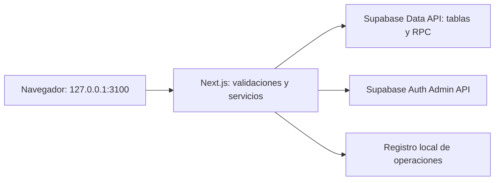

# Plan de repositorio: portal de gestión B2Car

Fecha: 23/10/2026. Nombre propuesto del repositorio: `b2car-admin`.

Este documento contiene el contexto necesario para implementar el portal en un repositorio independiente. La primera versión corre en la computadora del operador y administra el proyecto Supabase indicado en su configuración. **Local describe al portal: la base puede ser la instancia remota que usa B2Car y las escrituras afectan esa instancia.** No es una aplicación sin conexión.

La propuesta aprovecha las tablas, los permisos y la función de alta existentes. No necesita ampliar el modelo de datos ni depende de que el servidor de B2Car esté ejecutándose. La revisión de grants del RPC indicada en la sección 4.1 puede requerir una migración de permisos en B2Car.

## 1. Objetivo y alcance de la primera versión

Entregar una herramienta para un único operador de B2Car que permita:

- Listar tenants, buscar por nombre, filtrar por estado y plan y abrir su detalle.
- Crear un tenant con administrador, taller principal y categorías iniciales.
- Editar el nombre del tenant, cambiar entre BASE/PRO y suspender/reactivar.
- Listar usuarios de Supabase Auth, crear usuarios y distinguir los que no tienen tenant.
- Asignar usuarios existentes a un tenant y cambiar su rol.
- Consultar roles, planes y catálogo de permisos; crear roles personalizados y editar las matrices de permisos de roles y planes.
- Ver los permisos efectivos de un usuario, explicando qué bloquea su rol o su plan.
- Ver cantidades de entidades, globales y por tenant, y altas dentro de un período.
- Conservar un registro local mínimo de las operaciones administrativas y de las altas incompletas.

Dejar para una versión posterior: publicación en internet, múltiples operadores, login administrativo propio, impersonación de usuarios, transferencias entre tenants, borrado definitivo de tenants/usuarios, emisión fiscal, gestión de certificados, cobros de suscripciones y analítica de eventos.

Suspender un tenant es la acción de gestión inicial para retirarlo del uso habitual. No se ofrecerá el RPC `eliminar_tenant` como acción del portal en esta versión.

## 2. Arquitectura y armado del repositorio

Usar una sola aplicación **Next.js con App Router y TypeScript**, con UI y Route Handlers en el mismo proyecto. Supabase JS se usa exclusivamente del lado servidor. Para este alcance no hace falta un backend separado, ORM ni otra base de negocio.



Dependencias propuestas: Next.js, React, TypeScript, `@supabase/supabase-js`, `server-only` y Zod para validar entradas. CSS con tokens propios basados en B2Car y componentes sencillos; Vitest para lógica y servicios, y Playwright para los recorridos principales. Fijar versiones concretas y guardar el lockfile al crear el repo; no copiar íntegramente el `package.json` de B2Car.

Estructura propuesta:

```text
b2car-admin/
  AGENTS.md
  README.md
  .env.example
  .gitignore
  package.json
  package-lock.json
  docs/
    PLAN.md                       # Copia de este documento
    database-contract.md          # Contrato confirmado contra el destino
    operations.md                 # Configuración, recuperación y límites
    reference/b2car/               # Referencias SQL puntuales, solo lectura
  src/
    app/
      page.tsx                    # Resumen global
      tenants/page.tsx
      tenants/nuevo/page.tsx
      tenants/[tenantId]/page.tsx
      usuarios/page.tsx
      usuarios/[userId]/page.tsx
      roles/page.tsx
      roles/[roleId]/page.tsx
      planes/page.tsx
      planes/[planId]/page.tsx
      api/                        # Endpoints de la sección 8
    components/ui/
    features/
      tenants/                    # Formularios, contratos y componentes
      users/
      access/
      metrics/
    server/
      supabase/admin.ts
      repositories/
      services/
      local-access.ts
      operation-journal.ts
    lib/
      env.ts
      logger.ts
      format.ts
      fechas.ts
    types/database.ts
  tests/
    unit/
    integration/
    e2e/
  .local/                         # Ignorado por Git
```

Los handlers validan HTTP y delegan; los servicios implementan los flujos, y los repositorios concentran consultas y actualizaciones explícitas. No crear endpoints genéricos que acepten nombres arbitrarios de tablas, columnas o SQL.

Configuración propuesta, únicamente del servidor:

```dotenv
SUPABASE_URL=https://PROJECT_REF.supabase.co
SUPABASE_SERVICE_ROLE_KEY=REEMPLAZAR_LOCALMENTE
PORTAL_ENV_LABEL=desarrollo
PORTAL_READ_ONLY=true
```

Scripts del nuevo repositorio: `dev` y `start` deben fijar `--hostname 127.0.0.1 --port 3100`; agregar `build`, `lint`, `typecheck`, `test` y `test:e2e`. En Windows, documentar el uso de `npm.cmd`.

El README debe permitir arrancar con esta secuencia: instalar dependencias con `npm.cmd ci`, copiar `.env.example` a `.env.local`, completar las dos credenciales, ejecutar `npm.cmd run dev`, revisar el proyecto conectado y habilitar escrituras cambiando `PORTAL_READ_ONLY=false` y reiniciando. La variable de solo lectura se comprueba en el servidor para cada mutación.

## 3. Acceso local y credenciales

La primera versión confía en el acceso a la computadora del operador y no necesita un usuario de Supabase para entrar al portal. Esto evita confundir al operador global con el rol `admin` de un tenant.

Reglas concretas para esta arquitectura:

- Escuchar únicamente en `127.0.0.1:3100`, tanto en desarrollo como con `start`.
- Validar `Host` contra `127.0.0.1:3100` en las rutas administrativas. Para mutaciones exigir `Origin: http://127.0.0.1:3100` y JSON; rechazar origen ausente o distinto. No habilitar CORS abierto ni mutaciones mediante GET.
- Mostrar siempre el nombre del ambiente y el hostname del proyecto Supabase. Las confirmaciones indican el recurso y el alcance real del cambio.
- Marcar los módulos administrativos con `import "server-only"`. No usar variables `NEXT_PUBLIC_` para la service role key, ni devolverla en HTML, JSON, logs o errores.
- Crear un cliente administrativo separado, con `persistSession: false`, `autoRefreshToken: false` y `detectSessionInUrl: false`. No llamar `signInWithPassword` ni cargar sesiones de usuarios en ese cliente.
- La service role omite RLS; cada actualización debe filtrar su identificador y, cuando corresponda, `tenant_id`, además de validar la pertenencia en el servicio. El servidor debe limitar los campos que admite y devuelve.
- `.env*`, salvo `.env.example`, y `.local/` quedan fuera de Git. El logger centralizado elimina secretos y datos personales innecesarios; no se registran cuerpos de alta con contraseñas.

Supabase documenta que las operaciones administrativas de usuarios se ejecutan en servidor y que la service role nunca debe llegar al navegador. [Referencia de creación de usuarios](https://supabase.com/docs/reference/javascript/auth-admin-createuser). El acceso administrativo puede omitir RLS; mezclarlo con un token de usuario modifica el contexto de autorización. [Referencia de RLS](https://supabase.com/docs/guides/database/postgres/row-level-security#bypassing-row-level-security).

Publicar esta aplicación requeriría diseñar autenticación y autorización de operadores antes de cambiar la forma de exposición.

## 4. Contrato de datos de B2Car

Lo siguiente se verificó en el esquema declarativo y código del checkout de B2Car al 23/10/2026, con HEAD `29d0676a1e3eaaa4e810c7274375f6f68430a68d`. No se consultó el esquema remoto ni sus datos durante la preparación del plan. Antes de habilitar escrituras, contrastar este contrato con el proyecto destino y generar sus tipos.

### 4.1. Administración y acceso

| Fuente | Campos que necesita el portal | Relación y uso |
| --- | --- | --- |
| `public.tenants` | `id`, `nombre`, `estado`, `plan_sub`, `fecha_creacion`, `updated_at` | PK `id`. `nombre` varchar(255). `plan_sub` referencia `subscription_plans.id`, default `BASE`. Estado: `activo` o `suspendido`. |
| Supabase Auth, entidad `auth.users` | `id`, `email`, `created_at`, `last_sign_in_at`, `email_confirmed_at`, nombre opcional en `user_metadata` | Leer/crear mediante `auth.admin`, no mediante `.from('users')` ni escrituras SQL a `auth.users`. Devolver al navegador un DTO reducido. |
| `public.tenant_members` | `cliente_id`, `tenant_id`, `rol` | **`cliente_id` es el UUID de `auth.users.id`**, no un cliente comercial. PK `cliente_id`: cada usuario admite una sola membresía. `tenant_id` referencia tenants; `rol` referencia roles. No tiene `created_at`. |
| `public.roles` | `id`, `nombre`, `descripcion`, `activo`, `created_at` | Catálogo global, sin `tenant_id`. Validar identificadores de hasta 50 caracteres por compatibilidad con `tenant_members.rol`. |
| `public.permissions` | `id`, `descripcion` | Catálogo global de capacidades conocidas por la aplicación. Lectura en V1; un permiso nuevo en la tabla no implementa su comportamiento en B2Car. |
| `public.role_permissions` | `role`, `permission`, `granted` | PK compuesta `(role, permission)`. FKs a roles y permissions. Solo `granted = true` concede. |
| `public.subscription_plans` | `id`, `nombre`, `descripcion`, `activo`, `created_at` | Catálogo global, sin `tenant_id`. El portal usa los planes existentes. |
| `public.plan_permissions` | `plan`, `permission`, `granted` | PK compuesta `(plan, permission)`. FKs a subscription_plans y permissions. Solo `granted = true` habilita. |

No existe una tabla pública de perfiles que deba crearse para este portal. No hay relación observada que convierta automáticamente un usuario de Auth en un registro de `empleados` o de `clientes`.

En el esquema revisado estas tablas públicas tienen RLS habilitado y grants para `service_role`. Las matrices y catálogos permiten lectura a `authenticated`; `tenant_members` tiene una política de lectura de la membresía propia. El portal usa el cliente administrativo, sin modificar esas políticas.

Hay un punto concreto para verificar en el destino: el DDL de `crear_tenant` declara `SECURITY DEFINER`, concede `EXECUTE` a `anon` y `authenticated` y no comprueba un operador administrativo en su cuerpo. Revocar `PUBLIC` no elimina esos grants explícitos. Si el proyecto remoto reproduce esa definición y el alta debe ser administrativa, restringir su ejecución a `service_role` y los roles internos necesarios mediante una migración en B2Car, comprobando antes sus consumidores. La condición local del portal no protege por sí sola un RPC remoto con grants amplios. Este hallazgo corresponde a la referencia del checkout; no se verificó su despliegue remoto.

### 4.2. Entidades para métricas y detalle

Todas las siguientes tablas tienen `id` y `tenant_id`. El portal consulta cantidades y los campos de identificación indicados; no necesita descargar sus registros completos.

| Entidad | Tabla | Columna para altas por período | Otros campos útiles |
| --- | --- | --- | --- |
| Tenants | `tenants` | `fecha_creacion` | `nombre`, `estado`, `plan_sub` |
| Talleres | `talleres` | `created_at` | `nombre`, `ubicacion`, `valor_hora`; detalle del tenant |
| Clientes comerciales | `clientes` | `fecha_creacion` | Contar la tabla base una sola vez |
| Vehículos | `vehiculos` | `created_at` | No hace falta leer patentes ni información del propietario |
| Arreglos | `arreglos` | `created_at` | `estado`; `fecha` es fecha operativa y no reemplaza la de alta |
| Productos | `productos` | `created_at` | Cada fila es un producto del tenant |
| Registros de stock | `stocks` | `created_at` | Una fila por producto/taller; contar filas no equivale a sumar unidades |
| Turnos | `turnos` | `created_at` | `fecha`/`hora` son la programación del turno |
| Empleados | `empleados` | `created_at` | Son personal del taller, no cuentas de acceso |
| Operaciones | `operaciones` | `created_at` | `fecha` es fecha operativa; `taller_id` puede ser nulo |
| Documentos fiscales | `facturas_electronicas` | `created_at` | `estado`, `documento_tipo`, `ambiente`, `autorizada_at` |
| Remitos | `remitos` | `created_at` | `clase`, `ambiente`; `fecha_emision` es fecha del documento |
| Cuentas financieras | `cuentas_financieras` | `created_at` | `nombre`, `tipo`, `activo`; no mostrar saldos en el resumen inicial |
| Categorías de arreglo | `categorias_arreglo` | `created_at` | `nombre`; verificar inicialización del tenant |

Membresías: contar `tenant_members` para usuarios asignados por tenant, pero no ofrecer “asignaciones creadas este mes”: esa tabla no registra la fecha de asignación. La fecha de creación de un usuario en Auth tampoco permite reconstruir cuándo se incorporó al tenant.

`particulares` y `empresas` son extensiones de `clientes`, no clientes adicionales. Las líneas de facturas, detalles de arreglos y líneas de operaciones tampoco se suman al conteo de la entidad principal.

### 4.3. Reglas de roles, planes y sesión que debe respetar el portal

```text
permiso efectivo = role_permissions.granted
                   AND plan_permissions.granted
                   para el mismo permission.id
```

- El rol sale de `tenant_members.rol`; el plan sale de `tenants.plan_sub`.
- Una fila ausente o con `granted = false` deniega. `admin` también está limitado por el plan.
- Roles y matrices son **globales**. Editar `admin`, por ejemplo, afecta a todos los usuarios con ese rol en todos los tenants. Editar un plan afecta a todos los tenants que lo usan.
- Para dar un acceso diferente a una persona, crear/clonar un rol y asignárselo. No hay permisos directos por usuario ni sobrescrituras por tenant en el modelo actual. Un rol creado para una persona sigue siendo global.
- Se admiten roles personalizados; sus IDs no deben depender de un enum cerrado en el portal.
- B2Car actualmente normaliza los planes únicamente como `BASE` y `PRO` en `src/lib/subscription.ts`. No ofrecer alta/renombrado de planes ni permitir asignar un ID nuevo aunque el catálogo de la base lo admitiera.
- Los campos `roles.activo` y `subscription_plans.activo` sirven para filtrar nuevas selecciones en el portal. La lógica de permisos revisada no los usa como una revocación; desactivarlos no garantiza quitar acceso a usuarios existentes.
- Algunas acciones de configuración fiscal también exigen literalmente `rol = 'admin'`. Un rol personalizado con los mismos permisos no garantiza equivalencia total con `admin`.

El hook `public.custom_claims(event jsonb)` toma la membresía y el tenant activo para emitir `tenant_id`, `user_role`, `tenant_name` y `plan_sub`. Sin membresía agrega el error `NO_TENANT`; con tenant inactivo, `TENANT_INACTIVE`. En `supabase/config.toml` está habilitado como hook de access token.

El portal escribe membresías y catálogos, **no fabrica JWT ni guarda tenant/rol en `user_metadata` como mecanismo de autorización**. Los cambios de membresía, estado, nombre o plan requieren un nuevo token para reflejarse en sus claims. No asumir que un hook equivale a revocar access tokens ya emitidos.

B2Car cachea permisos por rol/plan durante 3.600 segundos en `src/lib/permissions.server.ts`. Cambiar una matriz puede reflejarse antes en los checks SQL que en la UI/API de B2Car. Renovar un token no invalida esa caché, y llamar `revalidateTag` desde el portal independiente tampoco invalida la caché de B2Car.

V1 debe informar “guardado en la base” y describir estas condiciones de aplicación. No prometer suspensión o revocación instantánea. Si eso fuera un requisito, se necesita un trabajo coordinado en B2Car para comprobaciones vigentes de membresía/estado e invalidación de caché; queda separado de este armado.

## 5. Flujos de gestión

### 5.1. Alta de usuario

Formulario: email, contraseña inicial y nombre opcional. La contraseña se envía una vez al handler y se limpia del formulario al terminar; no se guarda en el registro local. V1 usa `auth.admin.createUser`; no necesita configurar envío de correos ni invitaciones.

Decisión propuesta: alta manual con email confirmado (`email_confirm: true`), informándolo al operador. La política de contraseña efectiva del proyecto es la autoridad; conservar sus errores de validación en una respuesta entendible.

El usuario puede crearse sin asignación y quedar identificado como “sin tenant”; no podrá usar normalmente B2Car hasta completar la membresía. Si el email ya existe, mostrar conflicto y permitir seleccionar la cuenta existente, sin modificar su contraseña automáticamente.

El listado usa `auth.admin.listUsers({ page, perPage })`. La búsqueda global por email y los totales no se calculan solo sobre la página visible: para la escala inicial, recorrer páginas en servidor y formar un índice reducido de usuarios con TTL corto, actualizado tras las altas. No almacenar contraseñas ni devolver objetos completos de Auth. [API de listado paginado](https://supabase.com/docs/reference/javascript/auth-admin-listusers).

### 5.2. Alta de tenant

El asistente reúne nombre del tenant, administrador existente sin membresía o nuevo usuario, taller principal (nombre y ubicación obligatorios), categorías y cuenta financiera inicial opcional. Permite elegir BASE o PRO.

Secuencia:

1. Validar entradas, existencia del rol `admin`, plan compatible y activo, y que el administrador no pertenezca a otro tenant.
2. Si corresponde, crear el usuario mediante Auth Admin y registrar su UUID con un `operationId` local, sin contraseña.
3. Invocar `supabase.rpc('crear_tenant', { p_config })` con el siguiente contrato.
4. Consultar y verificar el tenant y los recursos devueltos. Si se pidió PRO, actualizar explícitamente `tenants.plan_sub` a PRO y verificar el valor guardado.
5. Mostrar el resultado con IDs y estados de cada paso; actualizar listados y métricas.

Payload real del RPC:

```json
{
  "tenant": { "nombre": "Taller de ejemplo" },
  "administrador_id": "UUID_DE_AUTH_USERS",
  "taller_principal": {
    "nombre": "Sede principal",
    "ubicacion": "Ubicación del taller"
  },
  "categorias_arreglo": ["Service", "Frenos", "Electricidad"],
  "cuenta_financiera_inicial": {
    "nombre": "Caja",
    "tipo": "EFECTIVO",
    "saldo_inicial": 0
  }
}
```

`cuenta_financiera_inicial` se puede omitir. Tipos permitidos: `EFECTIVO`, `CUENTA_BANCARIA`, `BILLETERA_DIGITAL` y `TARJETA_CREDITO`. Si hay saldo inicial distinto de cero, el RPC delega la apertura al flujo financiero existente. No insertar un saldo por fuera de ese flujo.

Si se omiten categorías, la función usa Service, Frenos y Electricidad; un array vacío o con nombres duplicados sin distinguir mayúsculas falla. Trim y validación también en el servidor del portal.

Respuesta del RPC:

```json
{
  "tenant_id": "uuid",
  "administrador_id": "uuid",
  "taller_principal_id": "uuid",
  "cuenta_financiera_id": null,
  "categorias": [{ "id": "uuid", "nombre": "Service" }]
}
```

La función crea en una transacción el tenant activo, la membresía `admin`, el taller, las categorías y la cuenta opcional. Valida que el administrador exista en Auth y no tenga otra membresía; usa locks para controlar altas concurrentes del mismo administrador.

**La firma actual no recibe plan ni lo lee de `tenant`: el tenant nace en BASE por default.** La actualización posterior a PRO es un paso separado. Auth Admin y el RPC tampoco comparten transacción.

Recuperación obligatoria:

- Si se creó el usuario y falla el RPC, conservarlo como usuario sin tenant y ofrecer continuar el alta usando ese UUID.
- Si el tenant quedó creado pero falla el cambio a PRO, indicar “tenant creado en BASE; cambio de plan pendiente” y reintentar solo ese cambio.
- Ante timeout del RPC, consultar la membresía del administrador y los recursos asociados antes de repetir. Una respuesta perdida no prueba que se revirtió la transacción.
- Deshabilitar doble envío y reutilizar el `operationId` para recuperar el progreso local después de un reinicio. Revalidar siempre contra la base; el registro local no reemplaza esa autoridad ni ofrece atomicidad distribuida.
- No borrar automáticamente usuarios o tenants para compensar errores.

Si más adelante se exige alta íntegramente atómica con plan elegido, extender `crear_tenant` mediante una migración en el repositorio dueño de la base. No simular esa garantía con varias llamadas HTTP.

### 5.3. Asignación y cambio de rol

Para asignar, seleccionar tenant, usuario y rol activo. El servidor verifica ambos recursos, el estado del tenant y la ausencia de membresía; inserta explícitamente `{ cliente_id: userId, tenant_id: tenantId, rol: roleId }`.

Si el usuario ya pertenece al mismo tenant, mostrar su membresía y usar el cambio de rol explícito. Si pertenece a otro, devolver conflicto; no hacer un `upsert` que lo traslade silenciosamente. La PK de `cliente_id` es la protección final ante concurrencia.

Para cambiar rol, filtrar por `cliente_id` y `tenant_id`; rechazar un resultado de cero filas y volver a leer. Impedir desde el servicio que el operador quite el último `admin` de un tenant. Esta comprobación es preventiva en la V1 de un operador; una garantía frente a ediciones simultáneas externas requiere una operación transaccional en base.

La desvinculación y transferencia de usuarios quedan fuera de V1. El cambio de rol informa que las sesiones anteriores pueden mantener los claims previos hasta renovarse.

### 5.4. Edición de tenants

Usar `UPDATE tenants ... WHERE id = tenantId`, con lista permitida de campos: `nombre`, `estado`, `plan_sub`. Leer el valor guardado y verificar que hubo una fila afectada.

Cambiar a suspendido requiere una confirmación que muestra nombre y UUID del tenant. Reactivar conserva usuarios y datos. Para los planes, permitir solo BASE/PRO compatibles con B2Car y presentes/activos en el catálogo; mostrar una previsualización de permisos que se ganan o pierden.

### 5.5. Roles y matrices de permisos

Presentar por dominio una tabla con permiso, descripción, valor del rol, valor del plan y resultado efectivo. Cargar el catálogo desde la base y tratar sus IDs como strings; no reducirlo a una lista fija del frontend.

Dominios observados en B2Car: dashboard, operaciones, finanzas, facturas, empleados, productos, configuración/taller, arreglos, clientes, vehículos y turnos. Hay capacidades específicas como `arreglos:precios:view`, `arreglos:precios:edit`, `arreglos:cobros:register` y `clientes:finanzas:view`. Tener un ID en el catálogo no prueba que todos los flujos lo validen; el simulador representa la matriz vigente.

Operaciones de V1:

- Crear un rol con ID de hasta 50 caracteres, nombre y descripción; iniciar sin permisos o clonando otro rol. Si falla la copia, conservar el rol y permitir completar la matriz.
- Editar `role_permissions` con un único upsert de las filas del catálogo para ese rol, usando `onConflict: 'role,permission'` y valores true/false explícitos, incluyendo las revocaciones. No hacer delete seguido de insert.
- Editar `plan_permissions` de la misma manera, con `onConflict: 'plan,permission'`. Mostrar cuántos tenants usan el plan antes de confirmar.
- Antes de cambiar un rol compartido, mostrar cuántos usuarios y tenants lo usan. Después de guardar, releer y recalcular la intersección.
- Mantener IDs de roles, planes y permisos estables; no ofrecer renombrado de IDs o borrado de catálogos.

El upsert de una matriz es una operación de base, pero no coordina por sí mismo cambios simultáneos externos. Releer antes de confirmar y advertir si cambió el estado que se estaba editando; no prometer control de concurrencia fuerte sin una versión o RPC específico.

## 6. Pantallas y experiencia de uso

| Pantalla | Contenido principal |
| --- | --- |
| Inicio | Ambiente/proyecto, tenants activos y suspendidos, usuarios Auth/asignados/sin tenant, entidades globales y altas del período |
| Tenants | Tabla paginada: nombre, estado, plan, fecha de creación y cantidad de miembros; filtros y acción “Crear tenant” |
| Nuevo tenant | Asistente de datos, administrador, recursos iniciales y revisión; resultado por paso y recuperación de alta incompleta |
| Detalle de tenant | Resumen editable; pestañas Usuarios, Talleres y configuración inicial, Permisos efectivos y Métricas |
| Usuarios | Listado/búsqueda, creación, tenant/rol y usuarios sin asignar |
| Detalle de usuario | Datos reducidos de Auth, membresía y rol, última entrada a Auth y matriz efectiva |
| Roles | Catálogo, creación/clonado, editor de matriz e impacto global |
| Planes | BASE/PRO, tenants que usan cada plan y editor de matriz global |

En todos los listados: carga, vacío, error y reintento. Las confirmaciones se reservan para cambios de estado y modificaciones con impacto global. Las altas incompletas deben seguir accesibles tras recargar.

Consultar los componentes de `src/app/components/ui/` antes de portar una base mínima. Se pueden adaptar Button, Modal, Dropdown, Card e inputs, junto con formatters; revisar sus dependencias y evitar copiar providers o llamadas a APIs de B2Car.

Centralizar formato `es-AR` y zona `America/Argentina/Buenos_Aires`. El checkout revisado tiene estilos en `src/globals.css` y `src/theme/theme.ts`; la ruta `src/app/theme/theme.css` citada en las instrucciones no existe en este checkout. Al portar la UI, resolver los tokens vigentes y mantenerlos centralizados.

## 7. Métricas: definiciones y consultas

Primera entrega: cantidades totales y altas del período para clientes, vehículos, arreglos, productos, turnos, empleados y operaciones. Agregar talleres, stock, documentos fiscales, remitos y cuentas como contadores secundarios. Selección inicial: últimos 30 días calendario de Argentina, incluyendo hoy; permitir un rango personalizado.

Reglas de cómputo:

- “Total actual” cuenta filas existentes. “Altas del período” cuenta filas existentes cuya fecha de creación cae en el rango. Sin historial de bajas no se puede reconstruir el total histórico de altas eliminadas.
- Usar la columna de creación de la tabla de la sección 4.2. Nunca sustituirla silenciosamente por `fecha`, `fecha_emision` o `fecha_comprobante`.
- Convertir el rango calendario de Argentina en límites `[desde 00:00 GMT-3, día siguiente a hasta 00:00 GMT-3)`. Enviar instantes completos y filtrar con `gte`/`lt`.
- Ejemplo: para el día 22/10/2026, usar `>= 2026-10-22T03:00:00.000Z` y `< 2026-10-23T03:00:00.000Z`. Un registro del 23 a las 01:30Z pertenece al 22 para el usuario.
- Si una fecha de creación es nula, incluir la fila en el total y excluirla de las altas por período, indicándolo cuando corresponda.
- “Usuarios Auth” sale de todas las páginas de Auth. “Usuarios asignados” sale de membresías. “Sin tenant” es la diferencia por UUID, no por email. La última entrada es `last_sign_in_at`; no representa actividad operativa en B2Car.
- “Documentos fiscales” puede incluir facturas, NC y ND. Si se muestra “facturas autorizadas”, exigir `documento_tipo = 'FACTURA'` y `estado = 'AUTORIZADA'`; separar homologación/producción. Para contar autorizaciones del período usar `autorizada_at` y etiquetarlo así.
- Registros de stock, productos y unidades en stock son métricas distintas. La V1 puede mostrar las dos primeras sin agregar sumas de existencias.

Consulta base de conteo, ejecutada en servidor:

```ts
const { count, error } = await admin
  .from("clientes")
  .select("id", { count: "exact", head: true })
  .eq("tenant_id", tenantId)
  .gte("fecha_creacion", fromInstant)
  .lt("fecha_creacion", toExclusiveInstant);
```

Para el total se omiten las fechas; para un resumen global se omite únicamente el filtro de tenant en un método explícitamente global. Fallos de consulta se muestran como “no disponible”, nunca como cero. Los conteos exactos evitan depender del límite de filas de una respuesta. [Conteos y relaciones en Supabase JS](https://supabase.com/docs/reference/javascript/select).

La comparación entre tenants debe paginarse (por ejemplo, 10 tenants) y mostrar las entidades principales. Para los totales se pueden usar conteos embebidos por las FKs desde tenants, por ejemplo `clientes(count)`, validando la respuesta real. Para las altas del rango y el detalle usar conteos filtrados con concurrencia limitada (por ejemplo, 4 solicitudes), solo para la página visible. No descargar todas las entidades ni ejecutar una consulta por cada tenant de la base al abrir el inicio.

Usar un TTL corto en memoria para métricas/índice de Auth, mostrar “actualizado a...” y ofrecer refrescar. No cachear las validaciones previas de escritura. Si una comparación completa termina siendo lenta, proponer después un RPC de agregación en una migración; no hacerlo requisito del primer portal.

Las lecturas de distintas tablas y Auth no comparten una instantánea transaccional. Bajo actividad concurrente los totales pueden variar ligeramente entre lecturas; no presentar el dashboard como una conciliación contable.

## 8. Contrato HTTP inicial

| Método y ruta | Responsabilidad |
| --- | --- |
| `GET /api/status` | Ambiente, hostname, modo solo lectura y comprobación mínima de conectividad, sin secretos |
| `GET /api/tenants` | Listar/paginar/filtrar tenants y conteo de miembros |
| `POST /api/tenants` | Orquestar el alta y devolver resultado por pasos con `operationId` |
| `GET /api/tenants/:id` | Tenant, miembros reducidos y configuración inicial |
| `PATCH /api/tenants/:id` | Nombre, estado o plan con validaciones específicas |
| `POST /api/tenants/:id/members` | Asignar un usuario sin membresía |
| `PATCH /api/tenants/:id/members/:userId` | Cambiar rol de esa membresía |
| `GET /api/users` | Listado/búsqueda de usuarios Auth y sus membresías |
| `POST /api/users` | Crear cuenta Auth |
| `GET /api/users/:id` | Datos reducidos de Auth, membresía y permisos efectivos |
| `GET /api/roles` y `POST /api/roles` | Listar y crear/clonar roles |
| `GET /api/roles/:id` | Rol y matriz |
| `PUT /api/roles/:id/permissions` | Guardar matriz y devolver impacto/estado confirmado |
| `GET /api/plans` y `GET /api/plans/:id` | Planes compatibles y sus matrices |
| `PUT /api/plans/:id/permissions` | Guardar matriz de plan |
| `GET /api/permissions` | Catálogo de capacidades |
| `GET /api/metrics` | Resumen global por rango |
| `GET /api/metrics/tenants` | Comparación paginada por rango |
| `GET /api/tenants/:id/metrics` | Conteos de un tenant |
| `GET /api/local-operations/:id` | Consultar progreso de un alta |
| `POST /api/local-operations/:id/resume` | Recuperar solo pasos pendientes tras revalidar en Supabase |

Todas las mutaciones validan modo de escritura y acceso local, parámetros, campos admitidos y referencias. Respuestas con códigos estables: `VALIDATION_ERROR`, `NOT_FOUND`, `USER_ALREADY_ASSIGNED`, `EMAIL_ALREADY_EXISTS`, `PARTIAL_PROVISIONING` y `SUPABASE_UNAVAILABLE`, además de un mensaje en español. Un resultado parcial devuelve los IDs ya confirmados para recuperarlo, sin volver a enviar credenciales.

El registro `.local/` conserva `operationId`, instantes, acción, UUIDs, estado por paso y error sanitizado. Puede registrar cambios administrativos con valores no sensibles anteriores/posteriores. Su propósito es soporte y recuperación del único operador; no constituye una auditoría central resistente a modificaciones.

## 9. Contexto que debe viajar al repositorio nuevo

Copiar este plan como `docs/PLAN.md`. Crear `docs/database-contract.md` con las secciones 4, 5.2 y 7, fecha, versión del origen y proyecto contra el que se confirmó el contrato.

Para implementar sin acceso al repo de B2Car, guardar como referencias puntuales de solo lectura:

- DDL de `tenants`, `tenant_members`, `roles`, `permissions`, `role_permissions`, `subscription_plans`, `plan_permissions`, `talleres`, `categorias_arreglo` y `cuentas_financieras`.
- Funciones `crear_tenant`, `custom_claims`, `_b2c179_tiene_permiso` y `current_tenant_id`; tipo `tenant_estado`.
- Una referencia del cálculo de intersección y de la caché de `src/lib/permissions.server.ts`, y la restricción BASE/PRO de `src/lib/subscription.ts`.
- La tabla de columnas de métricas y los formatters necesarios; los tipos generados del proyecto Supabase confirmado.

Estas referencias documentan el contrato: **no son una cadena de migraciones que deba ejecutarse ni una copia sincronizada de toda la aplicación**. No llevar `.env`, certificados, claves, datos de clientes ni el seed de desarrollo de B2Car.

Regla de propiedad: B2Car conserva inicialmente el control del esquema compartido. Todo cambio futuro se incorpora como migración en `b2car-app/supabase/migrations/`; no mantener dos historiales independientes sobre la misma base. No editar a mano `supabase/schemas/`.

No hacen falta permisos nuevos para el operador dentro de `roles`: ese catálogo corresponde a los usuarios de tenants. Si en el futuro se agregan objetos administrativos de base, sus grants deben ser explícitos y mínimos; una tabla exclusiva del portal no debe conceder acceso a `anon` o `authenticated` por costumbre.

## 10. Orden de implementación y criterios de entrega

| Etapa | Trabajo | Se considera terminada cuando |
| --- | --- | --- |
| 0. Contrato | Confirmar esquema del destino, hook, catálogos, RPC y grants; resolver el alcance de ejecución de `crear_tenant` y generar tipos | Se conocen discrepancias, el alta queda reservada al acceso administrativo previsto y el modo lectura funciona sin ejecutar altas |
| 1. Base local | Scaffold, configuración validada, cliente server-only, guardas locales, logger, UI y modo lectura | Arranca en 127.0.0.1:3100 y no expone la key; mutaciones bloqueadas en modo lectura |
| 2. Consultas | Tenants, usuarios paginados, detalle, catálogos y permisos efectivos | Se ve correctamente una cuenta sin tenant, una BASE y una PRO |
| 3. Altas y gestión | Crear usuario, RPC de tenant, recuperación, asignación, cambio de rol, estado y plan | Un alta completa queda lista para iniciar sesión en B2Car; se recuperan fallos parciales sin duplicar |
| 4. Permisos | Crear/clonar roles, editar matrices y mostrar alcance global | Un permiso concedido por rol pero negado por plan aparece bloqueado; las revocaciones se guardan |
| 5. Métricas | Totales y altas por rango, detalle y comparación paginada | Los números coinciden con conteos independientes y respetan GMT-3 |
| 6. Cierre | Pruebas, documentación y revisión del flujo completo | Otro desarrollador puede configurar y usar el repo siguiendo el README |

Pruebas de valor para este alcance:

- Intersección rol/plan: true/true concede; false, ausencia o permiso solo en una matriz deniega.
- Validación de membresía: asignación al mismo tenant, conflicto con otro y violación concurrente de PK; cambio de rol de una membresía inexistente y protección preventiva del último admin.
- Alta con Auth exitoso y RPC fallido; RPC confirmado con cambio a PRO fallido; timeout con tenant ya creado y recuperación tras reinicio.
- Seguridad del servidor: JSON/Origin/Host, modo solo lectura, campos rechazados y ausencia de la service role en respuestas y bundles del navegador.
- Usuarios con más de una página de Auth y métricas con más de 1.000 entidades; errores visibles sin convertirlos en cero.
- Rango en GMT-3, registro cerca de medianoche UTC, fechas de alta nulas y distinción entre creación y fecha operativa.
- Guardado de matrices con revocaciones y confirmación del impacto global.
- Un recorrido de navegador: crear cuenta y tenant, asignar un segundo usuario, cambiar rol/plan, consultar métricas y suspender/reactivar.

Ejecutar lint, tipos, unitarias y build. Las pruebas de integración y navegador con escrituras usan una instancia de desarrollo identificada explícitamente y recursos exclusivos de prueba; no reutilizar el harness de B2Car que trunca `auth.users`. No ejecutar resets sobre la base compartida.

La verificación de acceso final debe incluir B2Car con un usuario de prueba y token renovado, teniendo en cuenta su caché. Un resultado correcto en el simulador del portal prueba la matriz guardada, no todos los controles de cada endpoint de B2Car.

## 11. Instrucción de arranque para el nuevo repositorio

> Implementar la V1 del portal local B2Car siguiendo `docs/PLAN.md`. Usar Next.js/TypeScript y Supabase JS exclusivamente en servidor con `SUPABASE_SERVICE_ROLE_KEY`. Antes de escribir, confirmar el contrato del destino y documentar discrepancias. Respetar que `tenant_members.cliente_id` referencia Auth y permite un único tenant por usuario; los permisos efectivos son rol ∩ plan, con catálogos globales y planes compatibles BASE/PRO. Reutilizar `crear_tenant(p_config)` y registrar sus pasos separados de Auth y del cambio a PRO para recuperar fallos parciales. Empezar en modo solo lectura, completar cada etapa y verificarla. No modificar el esquema compartido ni los datos de negocio fuera de los flujos del plan.

## 12. Evidencia y referencias

Fuentes del repositorio de origen, con rutas relativas a `b2car-app`:

- `supabase/schemas/public/tables/{tenants,tenant_members,roles,permissions,role_permissions,subscription_plans,plan_permissions}.sql`: estructura, relaciones, RLS y grants de administración.
- `supabase/schemas/public/functions/crear_tenant.sql`: contrato real de alta, recursos creados y límites transaccionales.
- `supabase/schemas/public/functions/{custom_claims,current_tenant_id,_b2c179_tiene_permiso}.sql` y `supabase/config.toml`: contexto de tenant y cálculo de acceso.
- `src/lib/{permissions.ts,permissions.server.ts,subscription.ts}`: permisos, roles abiertos, caché y planes compatibles.
- `src/lib/facturacion/serverAuth.ts`: comprobaciones que todavía requieren el rol literal admin.
- `supabase/schemas/public/tables/`: columnas de alta y relaciones de las entidades de métricas.
- `src/supabase/admin.ts`: cliente administrativo separado ya utilizado por B2Car.
- `src/lib/{format,fechas}.ts`: convenciones de formato y zona horaria.

Se priorizaron esquema y código actuales frente a notas históricas de tiering. No se reconstruyó el esquema desde migraciones ni se modificó la base al elaborar este plan.
